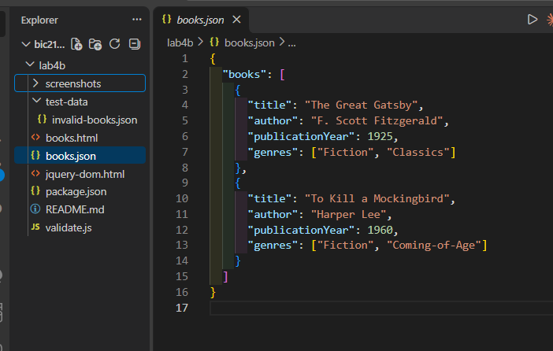
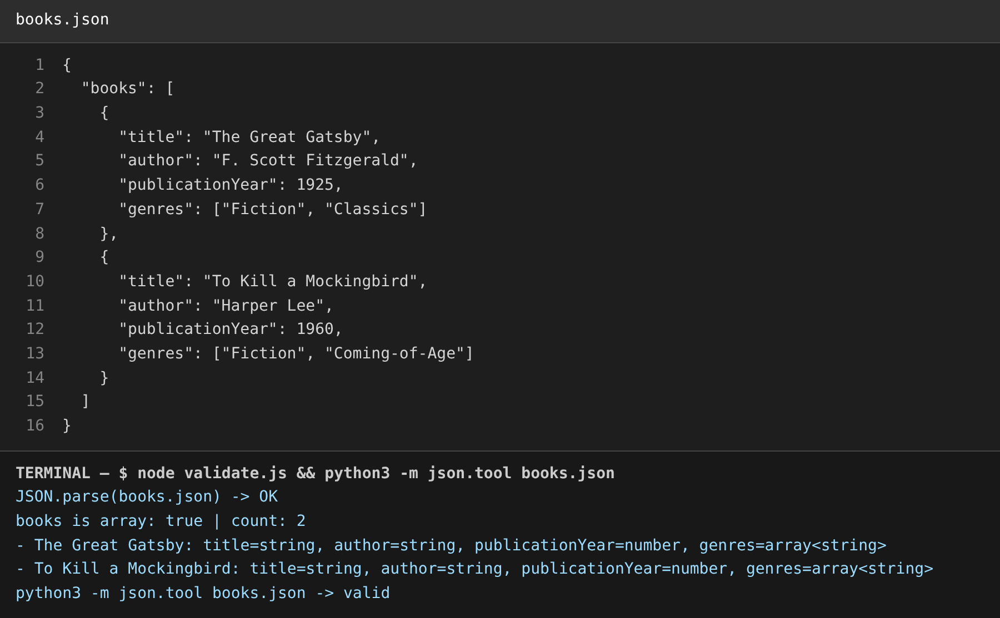
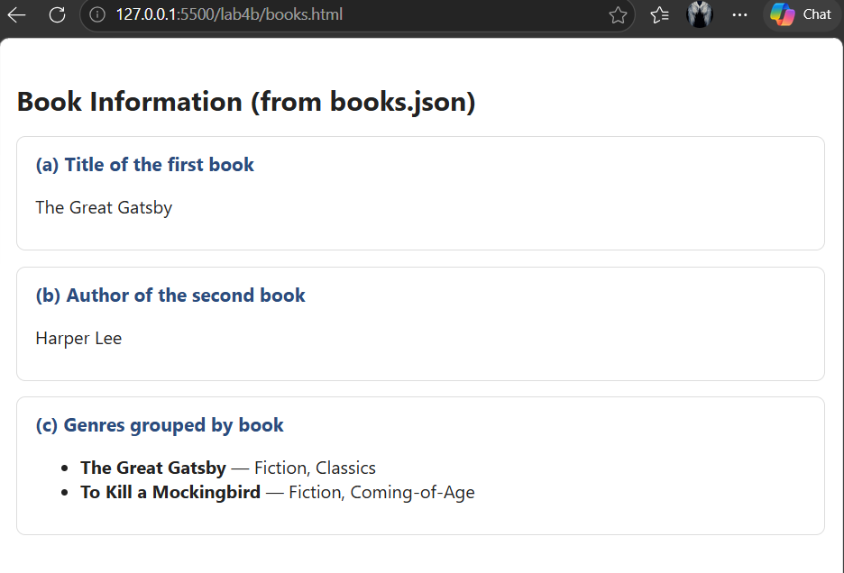
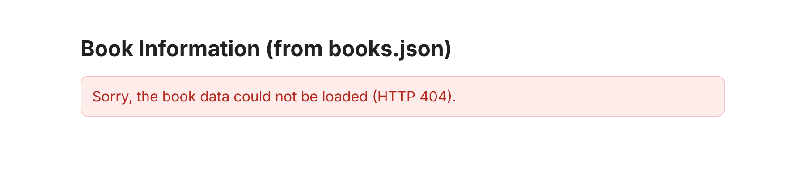
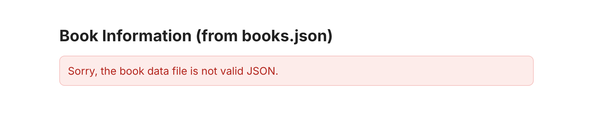
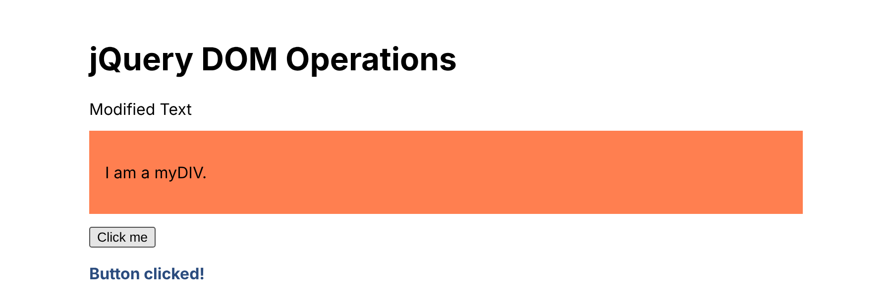

# BIC21203 Web Development – Lab 4b: JSON and jQuery

**Student:** Kirthetharan Sehkar (AI240016)
**Course:** BIC21203 Web Development, FSKTM, UTHM

This repository contains my solutions for Lab #4b (Client-Side Scripting: JSON and jQuery).

| File | Question | Purpose |
|---|---|---|
| `books.json` | Q1 | Valid JSON dataset with a top-level `books` array (2 books) |
| `validate.js` | Q1 | Optional Node script that parses `books.json` and checks field types |
| `books.html` | Q2 | Loads `books.json` with `fetch()` and displays the required items on the page |
| `jquery-dom.html` | Q3 | jQuery 4.0.0 equivalents of three native DOM operations |
| `test-data/invalid-books.json` | Q2 | Deliberately broken JSON, used only to demonstrate error handling |
| `screenshots/` | – | Evidence screenshots used in the report |

## Setup and running

`fetch()` cannot load local files when a page is opened with `file://`, so the pages must be served from a local web server.

**Option A – VS Code Live Server**
1. Open this folder in VS Code.
2. Install the *Live Server* extension (Ritwick Dey).
3. Right-click `books.html` → **Open with Live Server** (opens `http://127.0.0.1:5500/books.html`).
4. Open `http://127.0.0.1:5500/jquery-dom.html` for Question 3.

**Option B – Python**
```bash
cd lab4b
python -m http.server 5500
```
Then visit `http://localhost:5500/books.html` and `http://localhost:5500/jquery-dom.html`.

**Validate the JSON (optional)**
```bash
node validate.js
python -m json.tool books.json
```

**Try the error handling (Q2)**
- Missing file (HTTP 404): `http://localhost:5500/books.html?src=missing.json`
- Invalid JSON: `http://localhost:5500/books.html?src=test-data/invalid-books.json`

`jquery-dom.html` loads jQuery from the official CDN (`https://code.jquery.com/jquery-4.0.0.min.js`), so it needs an internet connection.

## Results

### Q1 – books.json parses successfully




### Q2 – Data displayed by books.html (VS Code Live Server, http://127.0.0.1:5500)


Error handling:




### Q3 – jQuery operations
After the page loads, `#myElement` reads "Modified Text" and `#myDIV` has the coral `myStyle` class. Clicking the button shows the "Button clicked!" alert.


